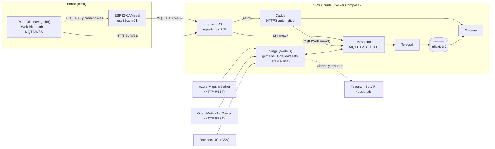

# Jefe IoT: arquitectura de referencia

**Escenario:** un "jefe virtual" vigila tu escritorio. Una ESP32-CAM mide movimiento y brillo; el servidor calcula si estás
*enfocado*, *distraído* o *ausente*, lleva un puntaje de productividad y dispara alertas. Alrededor hay un hogar inteligente
(gemelos digitales), datos del clima y del aire (APIs) y datasets reales de energía y ocupación.

## Diagrama

## Elementos fundamentales de IoT

| Elemento | Implementación |
|---|---|
| **Sensores y dispositivos** | ESP32-CAM real + 5 gemelos digitales + 2 APIs + 3 datasets (tabla abajo) |
| **Datos y variables** | Telemetría JSON numérica por dispositivo, 3 a 11 variables cada uno |
| **Protocolos** | MQTT 3.1.1 sobre TLS (placa), MQTT sobre WebSocket seguro (panel), HTTP REST (APIs y snapshot), BLE GATT (aprovisionamiento) |
| **Plataforma** | Mosquitto (bróker) + bridge (endpoints lógicos) + Telegraf → InfluxDB |
| **Visualización** | Grafana (37 paneles, alertas como anotaciones) y panel 3D en three.js |
| **Retroceso** | Cada dispositivo acepta `jefe/<id>/cmd`: apagar, ajustar intervalo, calibrar, accionar |
| **Nube / URL propia** | VPS propio, Docker Compose, HTTPS automático (Let's Encrypt), CI/CD con GitHub Actions |

## Dispositivos (11) y protocolo

| # | ID | Tipo | Protocolo | Variables (rango) |
|---|---|---|---|---|
| 1 | `esp32cam-01` | **Real** | MQTT/TLS, HTTP, BLE | motion 0-100, brightness 0-255, rssi dBm, heap B, chip_temp °C, uptime_s, flash 0/1, cam_ok 0/1 |
| 2 | `cam-sala-twin` | Digital Twin | MQTT | motion 0-100, brightness 0-255, fps, rssi, heap, chip_temp |
| 3 | `termostato-twin` | Digital Twin | MQTT | temp_sala/cuarto/cocina 10-30 °C, hum_* 35-85 %, setpoint, heating 0/1 |
| 4 | `enchufe-twin` | Digital Twin | MQTT | power_w 0-300, voltage_v ~120, current_a, energy_kwh, relay 0/1 |
| 5 | `puerta-twin` | Digital Twin | MQTT | door_open, window_open, pir (0/1), openings |
| 6 | `luz-twin` | Digital Twin | MQTT | on 0/1, brightness_pct 0-100, lux_ambient 0-700, power_w |
| 7 | `api-azure-weather` | **API** | HTTP REST → MQTT | temperature °C, real_feel, humidity %, wind_kmh, gust_kmh, uv_index, cloud_cover %, visibility_km, pressure_mb |
| 8 | `api-openmeteo-aq` | **API** | HTTP REST → MQTT | pm2_5, pm10 µg/m³, us_aqi, uv_index, co_ugm3, no2_ugm3 |
| 9 | `ds-energia` | **Dataset** (UCI Appliances Energy) | CSV → MQTT | appliances_wh, lights_wh, t_cocina, t_sala, t_exterior, rh_*, viento |
| 10 | `ds-co2` | **Dataset** (UCI Occupancy Detection) | CSV → MQTT | co2 ppm, luz lux, temperatura, humedad, razon_humedad |
| 11 | `ds-ocupacion` | **Dataset** (UCI Occupancy Detection) | CSV → MQTT | ocupado 0/1, luz, temperatura, humedad |
| (derivado) | `boss` | Calculado en el servidor | MQTT | score 0-100, state 1/2/3, state_s, motion_avg, focused/distracted/absent_min, focus_pct, xp, level |

Los gemelos digitales **reaccionan a la presencia real**: si la cámara detecta movimiento, el enchufe sube su consumo,
la luz se enciende en auto y el PIR se activa.

## Datos simulados ahora, reales después
La ESP32-CAM real publica en `jefe/esp32cam-01/telemetry`. Mientras no llegue nada en 90 s, el `bridge` simula esa misma
telemetría con el campo `sim=1` (el dashboard muestra "SIMULADA"). En cuanto llegan datos reales, la simulación se apaga sola
y se registra el evento `fuente_datos`. No se rellena el pasado: el histórico se acumula en vivo.

## Comunicación (envío y recepción)

| Tópico | Sentido | Contenido |
|---|---|---|
| `jefe/<id>/telemetry` | dispositivo → bróker | JSON numérico, cada 10-15 s (APIs cada 5 min) |
| `jefe/<id>/cmd` | panel → dispositivo | `{"enabled":0,"interval_s":30,"setpoint":22,"gain":6,"flash":true,...}` |
| `jefe/<id>/state` | dispositivo → panel (retenido) | parámetros actuales |
| `jefe/<id>/status` | LWT (retenido) | `online` / `offline` |
| `jefe/<id>/event` | bridge → Influx | alertas `{rule, severity, device, value, msg}` |
| `jefe/esp32cam-01/snap` / `live` | placa → panel | JPEG por MQTT y movimiento en vivo, solo mientras alguien mira |
| `jefe/boss/cmd` | panel → bridge | `{"reset":true}`, `{"personality":"estricto"\|"motivador"\|"sarcastico"}` |
| `jefe/boss/state` · `stats` · `report` | bridge → panel (retenidos) | personalidad; xp, nivel, rachas y logros; reporte del día y de la semana (ver [CONTRATO-V2.md](CONTRATO-V2.md)) |

La placa acepta además en `cmd`: `interval_s` y `noise` (0-40, firmware 2.1.0). Las APIs pueden publicar `stale=1` y `age_s`
cuando el bridge reenvía el último valor bueno porque la API falló; cada evento lleva `ts` e `id`.

Seguridad: usuarios `esp32`, `panel` y `backend` con ACL distintas (`mosquitto/acl`): la placa solo puede escribir en
`jefe/esp32cam-01/...` y leer su `cmd` (no puede suplantar a otros dispositivos); el panel lee todo y solo escribe `jefe/+/cmd`;
`backend` (bridge y Telegraf) lee y escribe `jefe/#`. TLS en el 443 con certificado de Let's Encrypt; la cámara solo transmite
mientras un panel autenticado la pide.

## Procesamiento y reglas (servidor)

| Regla | Condición | Severidad |
|---|---|---|
| `distraido_prolongado` | estado distraído ≥ 60 s | warning |
| `ausente_largo` | ausente > 30 min entre 9 y 18 h | info |
| `co2_alto` | CO₂ > 1000 ppm (>1500 crítica) | warning / critical |
| `temperatura_alta` | sala > 28 °C | warning |
| `consumo_alto` | enchufe > 300 W | info |
| `puerta_abierta_larga` | puerta abierta > 10 min | warning |
| `movimiento_sospechoso` | puerta abierta sin presencia (cámara ausente y PIR = 0) | critical |
| `aire_exterior_malo` | AQI > 100 | warning |
| `api_error` / `api_recuperada` | falla de una API / la API vuelve a responder | warning / info |
| `fuente_datos` | cambio real ↔ simulado | info |
| `logro` | se desbloquea un logro de gamificación | info |

Grafana permite ajustar la **ventana de agregación** (10 s a 1 h) y la **función** (promedio, máximo, mínimo, último),
y la tabla de **estadísticas** calcula promedio, máximo, mínimo y número de muestras por variable en el rango elegido.
Cada alerta aparece también como **anotación** (marca vertical) en todas las gráficas de tiempo. El dashboard se genera con
`python tools/gen_dashboard.py` (no se edita el JSON a mano) y se verifica con `python tools/check_dashboard.py`.

Las alertas con severidad ≥ `TELEGRAM_MIN_SEVERITY`, los logros y los reportes diario/semanal pueden llegar por **Telegram**
(opcional, ver [DEPLOY.md](DEPLOY.md#7-telegram-opcional)).

## Tecnologías
ESP32-CAM (Arduino/PlatformIO, NimBLE) · Mosquitto 2.0.20 · nginx 1.30 (stream SNI) · Caddy 2.11 · Telegraf 1.32 · InfluxDB 2.7 · Grafana 11.3 ·
Node.js 22 (bridge, mqtt.js) · three.js r170 · Web Bluetooth · Docker Compose · GitHub Actions · Let's Encrypt.

## Referencias
- Azure Maps Weather REST API: https://learn.microsoft.com/rest/api/maps/weather
- Open-Meteo Air Quality API: https://open-meteo.com/en/docs/air-quality-api
- Candanedo, L. M. (2017). *Appliances Energy Prediction*. UCI Machine Learning Repository.
- Candanedo, L. M. & Feldheim, V. (2016). *Occupancy Detection*. UCI Machine Learning Repository.
- MQTT 3.1.1, OASIS Standard. Bluetooth Core Specification (GATT).
